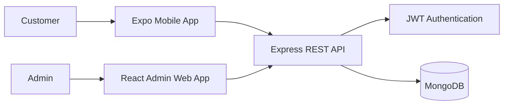

# Chowly — Food Delivery Platform

Chowly is a full-stack food-delivery platform in development, with a customer-facing mobile app, a REST API, and a web admin app scaffold.

The project is organized as three independent applications: an Expo app for customer onboarding and account management, an Express API backed by MongoDB, and a React/Vite admin frontend that is ready for dashboard development.

## Highlights

- Customer registration and sign-in with JWT-based sessions
- Saved delivery addresses, default-address selection, and location onboarding
- Shared API for mobile and web clients
- Expo Router navigation with native and web targets
- Theme-aware mobile UI built with Uniwind and Tailwind CSS
- Express API validation, password hashing, rate limiting, and authenticated endpoints

## Application Surfaces

| App           | Location              | Current scope                                                                                          |
| ------------- | --------------------- | ------------------------------------------------------------------------------------------------------ |
| Customer app  | [`mobile/`](./mobile) | Expo app with welcome, sign-up, sign-in, location onboarding, saved addresses, and customer tab routes |
| API           | [`server/`](./server) | Express and MongoDB API for authentication and address management                                      |
| Admin web app | [`admin/`](./admin)   | React/Vite scaffold; the restaurant, order, and delivery management dashboard is not implemented yet   |

## Current API

All API routes are prefixed with `/api/v1`.

| Method   | Endpoint                 | Description                                       |
| -------- | ------------------------ | ------------------------------------------------- |
| `POST`   | `/auth/register`         | Register a customer                               |
| `POST`   | `/auth/login`            | Sign in                                           |
| `POST`   | `/auth/logout`           | Clear the authentication cookie                   |
| `GET`    | `/auth/me`               | Return the authenticated user and default address |
| `GET`    | `/addresses`             | List the authenticated user's addresses           |
| `POST`   | `/addresses`             | Create an address                                 |
| `PATCH`  | `/addresses/:id`         | Update an address                                 |
| `PATCH`  | `/addresses/:id/default` | Make an address the default                       |
| `DELETE` | `/addresses/:id`         | Delete an address                                 |

The API also exposes `GET /health` as a basic health check.

## Architecture



## Tech Stack

- **Mobile:** React Native, Expo SDK 57, Expo Router, TypeScript
- **Mobile styling:** Tailwind CSS 4, Uniwind
- **Client data and networking:** TanStack React Query, Axios
- **Admin frontend:** React 19, TypeScript, Vite
- **Backend:** Node.js, Express 5, TypeScript
- **Database:** MongoDB with Mongoose
- **Authentication and validation:** JWT, Passport JWT, bcryptjs, Zod

## Project Structure

```text
admin/
  src/                 # React/Vite admin web app
mobile/
  src/app/             # Expo Router screens and route layouts
  src/features/        # Authentication, location, and settings logic
  src/components/      # Shared mobile UI components
  src/lib/             # API client and query configuration
server/
  src/config/          # Environment and database configuration
  src/controllers/     # HTTP request handlers
  src/middlewares/     # Authentication, validation, and error handling
  src/models/          # Mongoose models
  src/routes/v1/       # Versioned API routes
  src/services/        # Authentication and address business logic
  src/validators/      # Zod request schemas
```

## Local Setup

### Prerequisites

- Node.js 22 or a compatible current LTS release
- npm
- MongoDB connection string (local MongoDB or MongoDB Atlas)
- Expo Go or an Android/iOS development environment for native testing

### 1. Install dependencies

Each app has its own `package.json`; install dependencies separately:

```bash
cd server
npm install

cd ../mobile
npm install

cd ../admin
npm install
```

### 2. Configure the API

Create `server/.env` with your own MongoDB connection string and a private JWT secret:

```env
NODE_ENV=development
PORT=8000
LOG_LEVEL=info
CORS_ORIGIN=http://localhost:8081,http://127.0.0.1:8081
MONGODB_URI=mongodb://127.0.0.1:27017/chowly
JWT_SECRET=replace-with-a-long-random-secret
JWT_EXPIRES_IN=7d
```

For MongoDB Atlas, use your Atlas connection string for `MONGODB_URI` and make sure your development machine is allowed to connect in the cluster's network access settings. Keep `.env` files and credentials out of commits.

Start the API from the `server` directory:

```bash
npm run dev
```

The server connects to MongoDB before it starts listening. Verify it at [http://localhost:8000/health](http://localhost:8000/health).

### 3. Configure and start the mobile app

For web running on the same computer, the default API URL is `http://localhost:8000/api/v1`. To override it, create `mobile/.env`:

```env
EXPO_PUBLIC_API_URL=http://localhost:8000/api/v1
```

For an Android emulator or physical device, use an address reachable from that device instead of `localhost`. For example, the standard Android emulator can usually reach the host machine at `http://10.0.2.2:8000/api/v1`; a physical device should use the computer's LAN IP. The API's `CORS_ORIGIN` must include the exact browser origin when testing on web.

Start Expo from the `mobile` directory:

```bash
npm start
```

Use the Expo terminal shortcuts to open the native app or web target. To launch web directly:

```bash
npm run web
```

### 4. Start the admin web app

The admin app is currently a Vite starter scaffold. Run it from the `admin` directory:

```bash
npm run dev
```

Vite prints the local URL when the development server starts.

## Common Commands

Run commands from the corresponding app directory:

```bash
# API (server/)
npm run dev
npm run typecheck
npm run build

# Customer app (mobile/)
npm start
npm run web
npm run lint

# Admin web app (admin/)
npm run dev
npm run build
npm run lint
```
